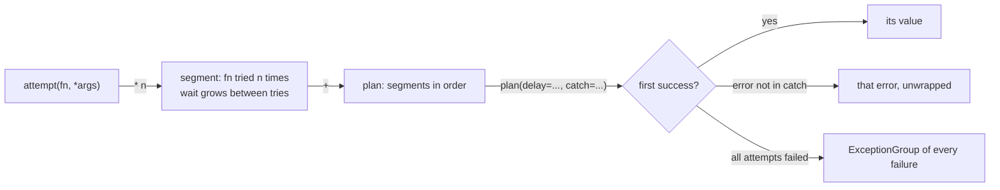

# User guide

retrpy has two public names, `attempt` and `Plan`. Everything else is ordinary Python:
operators to build a plan, keyword arguments to run it.

| Topic | What it covers | Page |
| --- | --- | --- |
| `attempt`, `*`, `+` | building plans: retry, fallback, defaults | [Building plans](plans.md) |
| `plan(...)` | running a plan, `catch` and failing fast | [Running a plan](running.md) |
| `delay`, `backoff`, `jitter`, `max_delay` | how long to wait between attempts | [Waits, backoff and jitter](waits.md) |
| `ExceptionGroup`, `on_failure` | logging failures and handling a plan that gave up | [When everything fails](failures.md) |
| `sleep` | fast, deterministic tests | [Testing](testing.md) |

## The mental model

1. `attempt(fn, *args, **kwargs)` binds a callable to its arguments: a plan of one attempt.
2. `* n` repeats it; `+` appends another plan as a fallback.
3. Calling the plan runs the attempts in order and returns the first success.

A plan is immutable: every operator returns a new plan, so you can name fragments once and
combine them wherever you need them.
